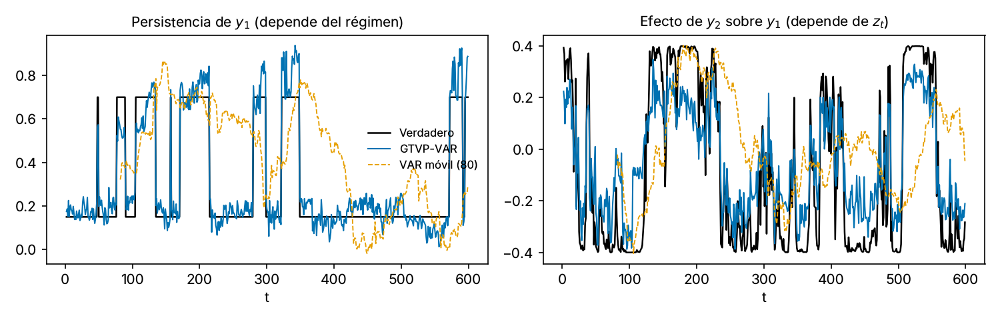
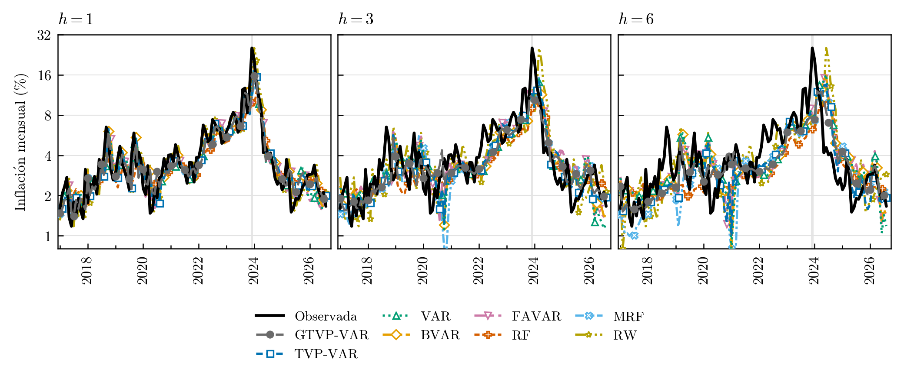
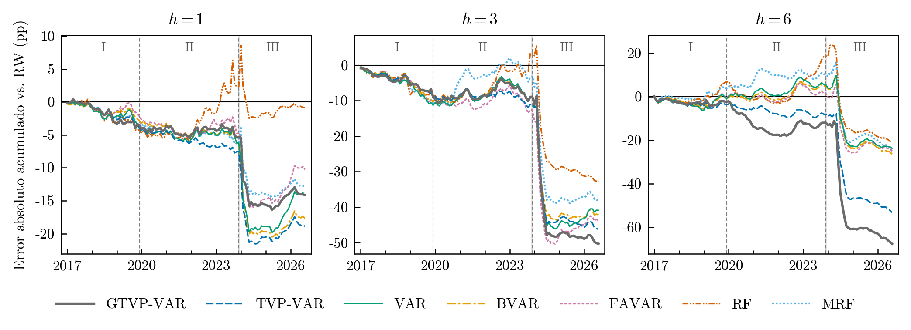
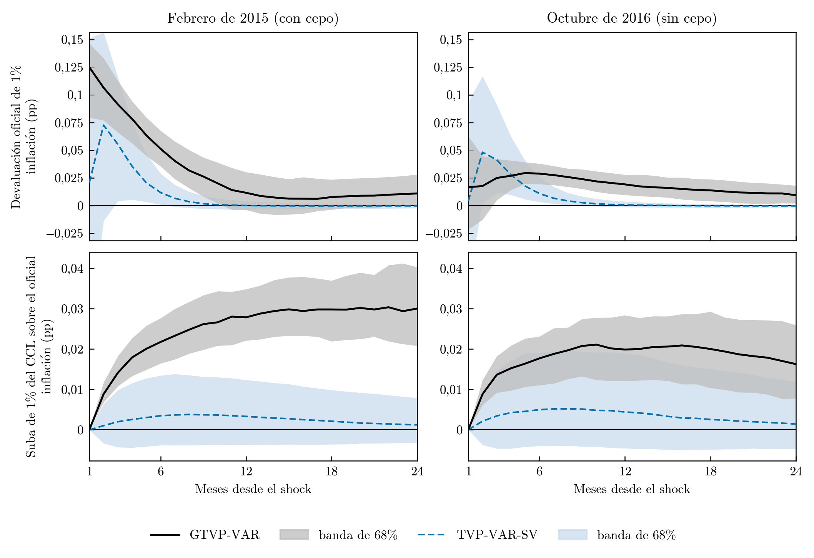

# GTVP-VAR

**Vectores autorregresivos con parámetros generalizados que varían en el tiempo, estimados con bosques aleatorios.**

[](https://github.com/EzequielGrillo/gtvp-var/actions/workflows/pruebas.yml)

[](https://github.com/EzequielGrillo/gtvp-var/blob/main/LICENSE)

`gtvpvar` es un paquete de Python para estimar VAR(p), con la cantidad de rezagos que se elija, cuyos coeficientes
dependen del estado de la economía. Extiende el *Macroeconomic Random Forest* (MRF) de Goulet Coulombe (2024) a varias
ecuaciones.

[English](https://github.com/EzequielGrillo/gtvp-var/blob/main/README.md) · **Español**

---

## El modelo

$$y_t = B(S_t)\, x_t + u_t, \qquad x_t = [1,\ y_{t-1},\ \dots,\ y_{t-p}]$$

- $y_t$: las $K$ variables del VAR.
- $S_t$: un vector de estado amplio (rezagos, otras variables macroeconómicas, una tendencia).
- $p$: la cantidad de rezagos del VAR, a elección.
- $B(S_t)$: la matriz de coeficientes ($K \times k$, con $k = 1 + Kp$), que sale de un bosque aleatorio.

Cada árbol particiona el espacio de estados con **cortes multivariados**. Un corte minimiza la suma, sobre las $K$
ecuaciones, del objetivo penalizado del MRF: un ridge hacia el MCO de la ventana. Cada hoja guarda un VAR completo y
el pronóstico usa el promedio de las matrices de los árboles.

Con $K = 1$ se obtiene el MRF. Con $K > 1$, el modelo tiene un VAR completo para cada estado. Eso permite iterar
pronósticos y calcular respuestas a impulsos, traspasos y descomposiciones de varianza que dependen del estado.

Detalles del algoritmo:

- **Bootstrap:** bayesiano por bloques (bloques contiguos de largo aleatorio, pesos Dirichlet(1, …, 1)).
- **Cortes:** exactos, sobre `mtry · p` columnas de $S$ sorteadas en cada nodo; la tendencia puede tener más
  probabilidad de salir sorteada.
- **Estimación:** la búsqueda de cortes usa un ridge simple. En las hojas, el ridge usa además un kernel de paseo
  aleatorio que suaviza los coeficientes en el tiempo.
- **Implementación:** motor numérico en `numba` y árboles en paralelo con `joblib`.

## Instalación

```bash
pip install gtvpvar
```

O, para tener también los ejemplos, desde el repositorio:

```bash
git clone https://github.com/EzequielGrillo/gtvp-var.git
cd gtvp-var
pip install -e .
```

Dependencias: `numpy`, `scipy`, `numba` y `joblib`. Los ejemplos usan además `pandas`, `scikit-learn`, `matplotlib`
y `openpyxl` (`pip install -e ".[ejemplos]"`). Para reproducir exactamente los resultados de los ejemplos, usar
las versiones fijadas en `requirements.txt` (Python 3.12):

```bash
pip install -r requirements.txt
```

## Uso

```python
from gtvpvar import GTVPVAR, matrices_var, pronosticar

X, Y = matrices_var(y, rezagos=4)           # VAR(4): x_t = [1, y_{t-1}, ..., y_{t-4}]
m = GTVPVAR(n_estimators=1000, ridge_lambda=0.15, rw_regularization=0.9, mtry=0.15,
            min_node_size=30, block_size=6, trend_push_column=S.shape[1] - 1,
            n_jobs=-1, random_state=1)
m.fit(X, S[4:], Y)                          # S: estado (T x p_s), alineado con Y

B = m.predict_beta(S_nuevo)                 # (n, K, k): matriz del VAR en cada estado
Bs = m.betas_arboles(S_nuevo)               # (árboles, n, K, k): una matriz por árbol
f = pronosticar(m, y, S[-1], h=12, rezagos=4)   # pronóstico iterado a 1..12 pasos (h x K)

m.guardar("bosque.npz")                     # y GTVPVAR.cargar("bosque.npz")
```

- **Rezagos:** `matrices_var(y, rezagos=p, constante=True)` arma `X` e `Y` para cualquier `p`. `fit` acepta
  cualquier `X`, así que también se pueden agregar regresores exógenos a la parte lineal.
- **Pronóstico:** en `pronosticar`, el estado puede quedar fijo (un vector), venir dado para cada paso (una matriz
  `h x p_s`) o calcularse con una función `f(paso, y_ext)`, que recibe la historia extendida con los pronósticos.
- **MRF:** con `Y` de una sola columna, o un vector, el modelo es un MRF.

### Parámetros

| Parámetro | Descripción | Por defecto |
|---|---|---|
| `n_estimators` | número de árboles | 1000 |
| `ridge_lambda` | penalización ridge hacia el MCO de la ventana (λ) | 0,15 |
| `rw_regularization` | peso del kernel de paseo aleatorio en las hojas (ζ, en [0, 1)) | 0,9 |
| `mtry` | fracción de columnas de S candidatas por nodo | 0,15 |
| `min_node_size` | tamaño mínimo de un nodo para cortarlo | 30 |
| `min_leaf_fraction` | cada hijo tiene al menos `ceil(min_leaf_fraction · k)` observaciones | 2 |
| `block_size` | largo medio de los bloques del bootstrap | 12 |
| `trend_push_column`, `trend_push_weight` | columna de la tendencia en S y factor de su probabilidad de sorteo | ninguna, 3 |
| `n_jobs` | procesos para ajustar los árboles | 1 |
| `random_state` | semilla (entero o lista de enteros) | ninguna |

## Ejemplos

### Datos sintéticos

[`ejemplos/datos_sinteticos.py`](https://github.com/EzequielGrillo/gtvp-var/blob/main/ejemplos/datos_sinteticos.py) simula un VAR cuya persistencia cambia con un régimen
observable, y el bosque recupera las dos matrices:

```bash
python ejemplos/datos_sinteticos.py
```

```
Regimen s <= 0 (A = 0,2 I): diagonal de A estimada = [0.06 0.12]
Regimen s > 0  (A = 0,8 I): diagonal de A estimada = [0.71 0.74]
```

### Demostración con datos simulados: comparación con otros modelos

[`ejemplos/simulacion.py`](https://github.com/EzequielGrillo/gtvp-var/blob/main/ejemplos/simulacion.py) simula un VAR(2) de 3 variables con coeficientes que dependen del
estado:

- un régimen persistente cambia la persistencia y la constante;
- una variable continua cambia, de forma no lineal, el efecto de una variable sobre otra;
- el estado que ven los modelos incluye además columnas de ruido.

Se pronostican las últimas 150 observaciones, reestimando cada 25 períodos.

```bash
python ejemplos/simulacion.py
```

RMSE relativo a un VAR(2) por MCO (promedio de las 3 variables), 150 pronósticos fuera de muestra por horizonte;
media y desvío (entre paréntesis) en 5 simulaciones. Menor es mejor. Los hiperparámetros se eligieron con otra
simulación, no con las de la evaluación. El "modelo verdadero" usa los coeficientes verdaderos y es una cota.

| Modelo | h=1 | h=3 |
|---|---:|---:|
| RW | 1,075 (0,041) | 1,093 (0,033) |
| VAR (MCO) | 1,000 (0,000) | 1,000 (0,000) |
| VAR móvil (80 obs.) | 1,328 (0,181) | 1,290 (0,104) |
| RF | 0,988 (0,062) | 0,982 (0,103) |
| MRF | 0,946 (0,022) | 1,090 (0,106) |
| **GTVP-VAR** | **0,957 (0,035)** | **0,980 (0,064)** |
| Modelo verdadero | 0,778 (0,056) | — |

El GTVP-VAR mejora al VAR lineal en los dos horizontes y tiene el menor error a h = 3, a la par del RF. A h = 1 el
MRF es apenas mejor, pero sus pronósticos directos empeoran a h = 3. A diferencia del RF, el GTVP-VAR da un VAR
interpretable en cada estado, que sigue de cerca a los coeficientes verdaderos:

<p align="center">
  <br>
  <em>Coeficientes verdaderos y estimados por el GTVP-VAR y por un VAR de ventana móvil.</em>
</p>

### Pronóstico de inflación en Argentina

[`ejemplos/inflacion_argentina/`](https://github.com/EzequielGrillo/gtvp-var/tree/main/ejemplos/inflacion_argentina) es una aplicación completa:

- un VAR de 5 variables con un estado de 70 columnas;
- pronósticos pseudo fuera de muestra a 1-6 meses de 2017 a 2026;
- selección de hiperparámetros en tiempo real;
- comparación con RW, VAR, BVAR, FAVAR, TVP-VAR, RF, MRF y la encuesta REM.

Incluye los resultados de referencia; el dataset no se distribuye. Se corre con:

```bash
python -m ejemplos.inflacion_argentina.correr_todo
```

Objetivos de 2017-01 a 2026-08 (115 por horizonte, sin diciembre de 2023). Error relativo al paseo aleatorio; menor
que 1 es mejor que el RW. Test de Giacomini-White contra el RW: \* p<0,10, \*\* p<0,05, \*\*\* p<0,01.

**MAE relativo al paseo aleatorio**

| Modelo | h=1 | h=2 | h=3 | h=4 | h=5 | h=6 |
|---|---:|---:|---:|---:|---:|---:|
| **GTVP-VAR** | **0,875\*** | **0,777\*** | **0,724\*** | **0,655\*** | **0,650\*** | **0,686\*** |
| TVP-VAR | 0,833\*\* | 0,776\*\* | 0,747\* | 0,728\*\* | 0,721\* | 0,753\* |
| TVP-VAR-SV | 0,817\*\* | 0,781\*\* | 0,746\*\* | 0,724\*\* | 0,726\* | 0,752\* |
| BVAR | 0,843\*\* | 0,797\* | 0,769\* | 0,756\* | 0,782\* | 0,878 |
| VAR | 0,874\* | 0,804 | 0,776 | 0,768\* | 0,799 | 0,890 |
| FAVAR | 0,909 | 0,812 | 0,761\* | 0,769\* | 0,799 | 0,884 |
| VAR pequeño | 0,898\* | 0,843 | 0,819 | 0,815\* | 0,878 | 0,994 |
| RF | 0,993 | 0,815 | 0,822 | 0,795 | 0,849 | 0,902 |
| MRF | 0,886 | 0,837\* | 0,791 | 0,874 | 0,836 | 0,885 |
| REM | 0,832\*\* | 0,755\*\* | 0,760\*\* | 0,732\* | 0,749 | 0,780 |

**RMSE relativo al paseo aleatorio**

| Modelo | h=1 | h=2 | h=3 | h=4 | h=5 | h=6 |
|---|---:|---:|---:|---:|---:|---:|
| **GTVP-VAR** | **0,812\*** | **0,717** | **0,617** | **0,576** | **0,547** | **0,604** |
| TVP-VAR | 0,777\*\* | 0,698 | 0,656 | 0,628 | 0,629 | 0,684 |
| TVP-VAR-SV | 0,755\*\* | 0,725 | 0,663 | 0,634 | 0,629 | 0,657 |
| BVAR | 0,768\*\* | 0,696 | 0,640 | 0,641 | 0,678 | 0,754 |
| VAR | 0,761\*\* | 0,692 | 0,634 | 0,639 | 0,682 | 0,761 |
| FAVAR | 0,802\* | 0,686 | 0,616 | 0,632 | 0,672 | 0,756 |
| VAR pequeño | 0,815\* | 0,718 | 0,689 | 0,689 | 0,742 | 0,831 |
| RF | 1,084 | 0,794 | 0,737 | 0,715 | 0,723 | 0,738 |
| MRF | 0,874 | 0,749\* | 0,643 | 0,786 | 0,731 | 0,736 |
| REM | 0,791\*\* | 0,658\* | 0,634 | 0,601 | 0,586 | 0,602 |

REM es el Relevamiento de Expectativas de Mercado del BCRA. El GTVP-VAR tiene el menor MAE desde h = 3; junto con
el TVP-VAR y el TVP-VAR-SV, es significativamente mejor que el RW en los seis horizontes.

<p align="center">
  <br>
  <em>Inflación observada y pronosticada a 1, 3 y 6 meses.</em>
</p>

<p align="center">
  <br>
  <em>Diferencia acumulada de error absoluto respecto del paseo aleatorio (negativo: mejor que el RW).</em>
</p>

<p align="center">
  <br>
  <em>Respuestas de la inflación a una devaluación y a un aumento de la brecha cambiaria, con y sin control de
  cambios.</em>
</p>

La especificación, las etapas, los tiempos y las tablas completas están en
[`ejemplos/inflacion_argentina/LEEME.md`](https://github.com/EzequielGrillo/gtvp-var/blob/main/ejemplos/inflacion_argentina/LEEME.md).

## Estructura

```
gtvpvar/                     el paquete: clase GTVPVAR (modelo.py) y rutinas numba (_nucleo.py)
ejemplos/
  datos_sinteticos.py        ejemplo mínimo, sin datos externos
  simulacion.py              demostración con datos simulados y comparación con otros modelos
  resultados_simulacion/     tabla y figura de la demostración
  inflacion_argentina/       aplicación completa: scripts, formato de los datos y resultados de referencia
tests/                       pruebas automáticas (pytest)
```

## Pruebas

```bash
pip install -e ".[test]"
pytest
```

## Créditos

El GTVP-VAR extiende el Macroeconomic Random Forest de Goulet Coulombe, P. (2024), "The macroeconomy as a random
forest", *Journal of Applied Econometrics*, 39(3). Es una implementación independiente, escrita a partir del paper; no
está asociada al autor del MRF.

## Licencia

[MIT](https://github.com/EzequielGrillo/gtvp-var/blob/main/LICENSE). Para citar el paquete, ver [`CITATION.cff`](https://github.com/EzequielGrillo/gtvp-var/blob/main/CITATION.cff).

