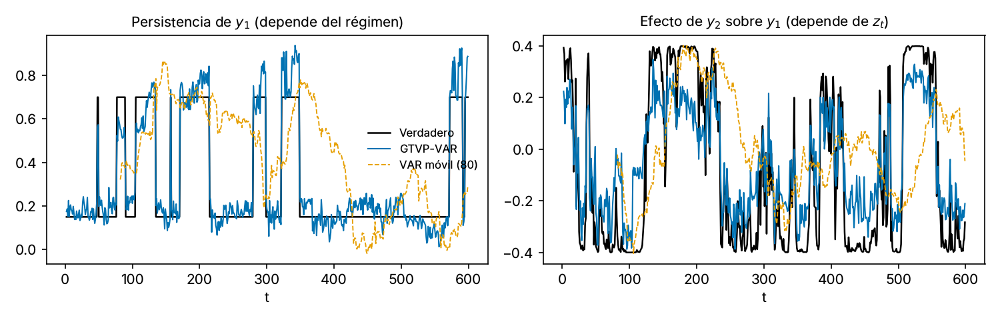
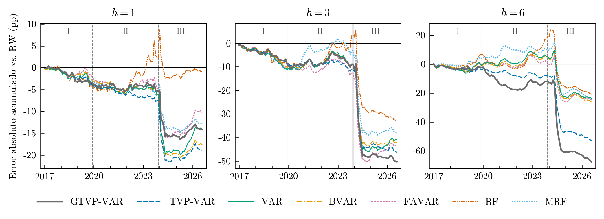

# GTVP-VAR

**Generalized time-varying parameter VARs, estimated with random forests.**

[](https://github.com/EzequielGrillo/gtvp-var/actions/workflows/pruebas.yml)

[](LICENSE)

`gtvpvar` is a Python package for VAR(p) models, with any lag order, whose coefficients depend on the state of the
economy. It extends Goulet Coulombe's (2024) *Macroeconomic Random Forest* (MRF) to several equations.

**English** · [Español](README.es.md)

---

## The model

$$y_t = B(S_t)\, x_t + u_t, \qquad x_t = [1,\ y_{t-1},\ \dots,\ y_{t-p}]$$

- $y_t$: the $K$ variables of the VAR.
- $S_t$: a large state vector (lags, other macroeconomic variables, a time trend).
- $p$: the lag order of the VAR, chosen by the user.
- $B(S_t)$: the $K \times k$ coefficient matrix ($k = 1 + Kp$), given by a random forest.

Each tree partitions the state space with **multivariate splits**. A split minimizes the sum, across the $K$
equations, of the MRF's penalized objective: a ridge regression shrunk towards the OLS estimate of the window. Each
leaf holds a full VAR, and the forecast averages the trees' matrices.

With $K = 1$ the model is the MRF. With $K > 1$ there is a full VAR for each state. That makes it possible to iterate
forecasts and to compute state-dependent impulse responses, pass-through and variance decompositions.

Algorithm details:

- **Bootstrap:** Bayesian block bootstrap (contiguous blocks of random length, Dirichlet(1, …, 1) weights).
- **Splits:** exact splits over `mtry · p` columns of $S$ drawn at each node; the trend column can be given a higher
  probability of being drawn.
- **Estimation:** the split search uses a plain ridge. In the leaves, the ridge also uses a random-walk kernel that
  smooths the coefficients over time.
- **Implementation:** numerical core in `numba`, trees fitted in parallel with `joblib`.

## Installation

```bash
git clone https://github.com/EzequielGrillo/gtvp-var.git
cd gtvp-var
pip install -e .
```

Dependencies: `numpy`, `scipy`, `numba` and `joblib`. The examples also need `pandas`, `scikit-learn`, `matplotlib`
and `openpyxl` (`pip install -e ".[ejemplos]"`). To reproduce the examples' results exactly, use the versions pinned
in `requirements.txt` (Python 3.12):

```bash
pip install -r requirements.txt
```

## Usage

```python
from gtvpvar import GTVPVAR, matrices_var, pronosticar

X, Y = matrices_var(y, rezagos=4)           # VAR(4): x_t = [1, y_{t-1}, ..., y_{t-4}]
m = GTVPVAR(n_estimators=1000, ridge_lambda=0.15, rw_regularization=0.9, mtry=0.15,
            min_node_size=30, block_size=6, trend_push_column=S.shape[1] - 1,
            n_jobs=-1, random_state=1)
m.fit(X, S[4:], Y)                          # S: state (T x p_s), aligned with Y

B = m.predict_beta(S_new)                   # (n, K, k): VAR matrix in each state
Bs = m.betas_arboles(S_new)                 # (trees, n, K, k): one matrix per tree
f = pronosticar(m, y, S[-1], h=12, rezagos=4)   # iterated forecast, 1..12 steps ahead (h x K)

m.guardar("forest.npz")                     # save; load with GTVPVAR.cargar("forest.npz")
```

- **Lags:** `matrices_var(y, rezagos=p, constante=True)` builds `X` and `Y` for any `p`. `fit` accepts any `X`, so
  exogenous regressors can also be added to the linear part.
- **Forecasting:** in `pronosticar`, the state can be held fixed (a vector), given for each step (an `h x p_s`
  matrix) or computed by a function `f(step, y_ext)`, which receives the history extended with the forecasts.
- **MRF:** with a single-column `Y`, or a vector, the model is an MRF.

The API is in Spanish: `matrices_var` (VAR matrices), `pronosticar` (forecast), `rezagos` (lags), `constante`
(intercept), `betas_arboles` (per-tree betas), `guardar` / `cargar` (save / load).

### Parameters

| Parameter | Description | Default |
|---|---|---|
| `n_estimators` | number of trees | 1000 |
| `ridge_lambda` | ridge penalty towards the window's OLS estimate (λ) | 0.15 |
| `rw_regularization` | weight of the random-walk kernel in the leaves (ζ, in [0, 1)) | 0.9 |
| `mtry` | fraction of the columns of S tried at each node | 0.15 |
| `min_node_size` | minimum size of a node to be split | 30 |
| `min_leaf_fraction` | each child has at least `ceil(min_leaf_fraction · k)` observations | 2 |
| `block_size` | mean block length of the bootstrap | 12 |
| `trend_push_column`, `trend_push_weight` | trend column in S and factor applied to its draw probability | none, 3 |
| `n_jobs` | processes used to fit the trees | 1 |
| `random_state` | seed (integer or list of integers) | none |

## Examples

### Synthetic data

[`ejemplos/datos_sinteticos.py`](ejemplos/datos_sinteticos.py) simulates a VAR whose persistence switches with an
observable regime; the forest recovers both matrices:

```bash
python ejemplos/datos_sinteticos.py
```

```
Regimen s <= 0 (A = 0,2 I): diagonal de A estimada = [0.06 0.12]
Regimen s > 0  (A = 0,8 I): diagonal de A estimada = [0.71 0.74]
```

### Simulation study: comparison with other models

[`ejemplos/simulacion.py`](ejemplos/simulacion.py) simulates a 3-variable VAR(2) with state-dependent coefficients:

- a persistent regime changes the persistence and the intercept;
- a continuous variable changes, non-linearly, the effect of one variable on another;
- the state seen by the models also includes pure-noise columns.

Each model forecasts the last 150 observations, re-estimated every 25 periods.

```bash
python ejemplos/simulacion.py
```

<!-- SIMULATION -->

<p align="center">
  <br>
  <em>True coefficients and those estimated by the GTVP-VAR and by a rolling-window VAR.</em>
</p>

### Forecasting inflation in Argentina

[`ejemplos/inflacion_argentina/`](ejemplos/inflacion_argentina) is a full application:

- a 5-variable VAR with a 70-column state;
- pseudo out-of-sample forecasts 1 to 6 months ahead, from 2017 to 2026;
- real-time hyperparameter selection;
- comparison with RW, VAR, BVAR, FAVAR, TVP-VAR, RF, MRF and the REM survey.

The reference results are included; the dataset is not distributed. Run it with:

```bash
python -m ejemplos.inflacion_argentina.correr_todo
```

Targets from 2017-01 to 2026-08 (115 per horizon, excluding December 2023). Errors relative to the random walk; below
1 is better than the RW. Giacomini-White test against the RW: \* p<0.10, \*\* p<0.05, \*\*\* p<0.01.

**MAE relative to the random walk**

| Model | h=1 | h=2 | h=3 | h=4 | h=5 | h=6 |
|---|---:|---:|---:|---:|---:|---:|
| **GTVP-VAR** | **0.875\*** | **0.777\*** | **0.724\*** | **0.655\*** | **0.650\*** | **0.686\*** |
| TVP-VAR | 0.833\*\* | 0.776\*\* | 0.747\* | 0.728\*\* | 0.721\* | 0.753\* |
| TVP-VAR-SV | 0.817\*\* | 0.781\*\* | 0.746\*\* | 0.724\*\* | 0.726\* | 0.752\* |
| BVAR | 0.843\*\* | 0.797\* | 0.769\* | 0.756\* | 0.782\* | 0.878 |
| VAR | 0.874\* | 0.804 | 0.776 | 0.768\* | 0.799 | 0.890 |
| FAVAR | 0.909 | 0.812 | 0.761\* | 0.769\* | 0.799 | 0.884 |
| Small VAR | 0.898\* | 0.843 | 0.819 | 0.815\* | 0.878 | 0.994 |
| RF | 0.993 | 0.815 | 0.822 | 0.795 | 0.849 | 0.902 |
| MRF | 0.886 | 0.837\* | 0.791 | 0.874 | 0.836 | 0.885 |
| REM | 0.832\*\* | 0.755\*\* | 0.760\*\* | 0.732\* | 0.749 | 0.780 |

**RMSE relative to the random walk**

| Model | h=1 | h=2 | h=3 | h=4 | h=5 | h=6 |
|---|---:|---:|---:|---:|---:|---:|
| **GTVP-VAR** | **0.812\*** | **0.717** | **0.617** | **0.576** | **0.547** | **0.604** |
| TVP-VAR | 0.777\*\* | 0.698 | 0.656 | 0.628 | 0.629 | 0.684 |
| TVP-VAR-SV | 0.755\*\* | 0.725 | 0.663 | 0.634 | 0.629 | 0.657 |
| BVAR | 0.768\*\* | 0.696 | 0.640 | 0.641 | 0.678 | 0.754 |
| VAR | 0.761\*\* | 0.692 | 0.634 | 0.639 | 0.682 | 0.761 |
| FAVAR | 0.802\* | 0.686 | 0.616 | 0.632 | 0.672 | 0.756 |
| Small VAR | 0.815\* | 0.718 | 0.689 | 0.689 | 0.742 | 0.831 |
| RF | 1.084 | 0.794 | 0.737 | 0.715 | 0.723 | 0.738 |
| MRF | 0.874 | 0.749\* | 0.643 | 0.786 | 0.731 | 0.736 |
| REM | 0.791\*\* | 0.658\* | 0.634 | 0.601 | 0.586 | 0.602 |

REM is the Central Bank of Argentina's survey of market expectations (*Relevamiento de Expectativas de Mercado*). The
GTVP-VAR has the lowest MAE from h = 3 onwards; together with the TVP-VAR and the TVP-VAR-SV, it is significantly
better than the RW at all six horizons.

<p align="center">
  <br>
  <em>Observed and forecast inflation, 1, 3 and 6 months ahead.</em>
</p>

<p align="center">
  <br>
  <em>Cumulative difference in absolute error relative to the random walk (negative: better than the RW).</em>
</p>

<p align="center">
  <br>
  <em>Responses of inflation to a devaluation and to a widening of the exchange-rate gap, with and without capital
  controls.</em>
</p>

The specification, stages, run times and full tables are in
[`ejemplos/inflacion_argentina/LEEME.md`](ejemplos/inflacion_argentina/LEEME.md) (in Spanish).

## Repository layout

```
gtvpvar/                     the package: GTVPVAR class (modelo.py), numba routines (_nucleo.py), VAR helpers (var.py)
ejemplos/
  datos_sinteticos.py        minimal example, no external data
  simulacion.py              simulation study comparing the GTVP-VAR with other models
  resultados_simulacion/     table and figure of the simulation study
  inflacion_argentina/       full application: scripts, data format and reference results
tests/                       automated tests (pytest)
```

## Tests

```bash
pip install -e ".[test]"
pytest
```

## Credits

The GTVP-VAR extends the Macroeconomic Random Forest of Goulet Coulombe, P. (2024), "The macroeconomy as a random
forest", *Journal of Applied Econometrics*, 39(3). This is an independent implementation written from the paper; it
is not affiliated with the author of the MRF.

## License

[MIT](LICENSE). To cite the package, see [`CITATION.cff`](CITATION.cff).
