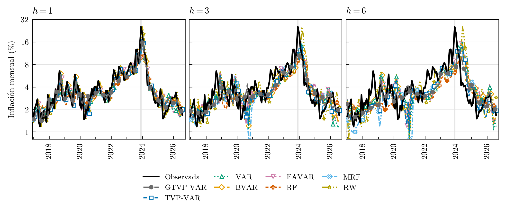
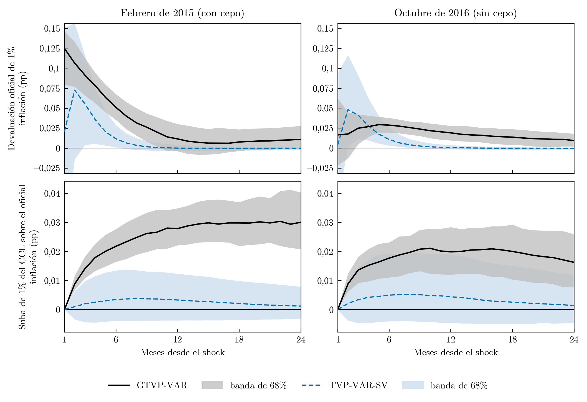

# GTVP-VAR

**Vectores autorregresivos con parámetros generalizados que varían en el tiempo, estimados con bosques aleatorios.**

[](https://github.com/EzequielGrillo/gtvp-var/actions/workflows/pruebas.yml)

[](LICENSE)

Implementación en Python del modelo GTVP-VAR y código de replicación de la tesis *Pronóstico de inflación en
Argentina con modelos de Machine Learning: el GTVP-VAR* (Grillo, Universidad de Buenos Aires, 2026).

[English summary](#english-summary)

---

## Qué es el GTVP-VAR

El GTVP-VAR es un VAR cuyos coeficientes dependen del estado de la economía:

$$y_t = B(S_t)\, x_t + u_t, \qquad x_t = [1,\ y_{t-1}],$$

donde $y_t$ tiene $K$ variables, $S_t$ es un vector de estado amplio (rezagos, variables monetarias, externas,
fiscales, una tendencia) y la matriz $B(S_t)$ ($K \times k$) sale de un bosque aleatorio. Cada árbol particiona el
espacio de estados con **cortes multivariados**: un corte minimiza la suma, sobre las $K$ ecuaciones, del objetivo
penalizado (ridge hacia el MCO de la ventana) del *Macroeconomic Random Forest* (MRF) de Goulet Coulombe (2024). Cada
hoja guarda un VAR completo y el pronóstico usa el promedio de las matrices de los árboles.

Es una extensión multivariada del MRF, que es el caso particular $K = 1$. Al tener un VAR completo en cada estado, el
modelo permite iterar pronósticos y calcular respuestas a impulsos, traspaso a precios y descomposiciones de varianza
que dependen del estado.

Detalles del algoritmo:

- bootstrap bayesiano por bloques (bloques contiguos de largo aleatorio, pesos Dirichlet(1, …, 1));
- cortes exactos sobre `mtry · p` columnas de $S$ sorteadas por nodo, con mayor probabilidad para la tendencia;
- búsqueda de cortes con ridge simple; en las hojas, ridge con el kernel de paseo aleatorio, que suaviza los
  coeficientes en el tiempo;
- motor numérico en `numba`, árboles en paralelo con `joblib`.

## Instalación

```bash
git clone https://github.com/EzequielGrillo/gtvp-var.git
cd gtvp-var
pip install -e .
```

Dependencias del paquete: `numpy`, `scipy`, `numba` y `joblib`. Para replicar la tesis exactamente, usar las versiones
fijadas (Python 3.12):

```bash
pip install -r requirements.txt
```

## Uso

```python
from gtvpvar import GTVPVAR

m = GTVPVAR(n_estimators=1000, ridge_lambda=0.15, rw_regularization=0.9, mtry=0.15,
            min_node_size=30, block_size=6, trend_push_column=S.shape[1] - 1,
            n_jobs=-1, random_state=1)
m.fit(X, S, Y)                  # X = [1, y_{t-1}] (T x k), S = estado (T x p), Y = y_t (T x K)
B = m.predict_beta(S_nuevo)     # (n, K, k): matriz del VAR en cada estado
Bs = m.betas_arboles(S_nuevo)   # (árboles, n, K, k): una matriz por árbol

m.guardar("bosque.npz")         # y GTVPVAR.cargar("bosque.npz")
```

Con `Y` de una sola columna (o un vector) se obtiene el MRF. Hay un ejemplo completo con datos sintéticos, que no
necesita el dataset de la tesis:

```bash
python ejemplos/ejemplo_minimo.py
pytest
```

### Parámetros

| Parámetro | Descripción | Tesis |
|---|---|---|
| `n_estimators` | número de árboles | 1000 (200 en las búsquedas) |
| `ridge_lambda` | penalización ridge hacia el MCO de la ventana (λ) | {0,15; 0,5; 1} |
| `rw_regularization` | peso del kernel de paseo aleatorio en las hojas (ζ) | {0,3; 0,6; 0,9} |
| `mtry` | fracción de columnas de S candidatas por nodo | {0,075; 0,15} |
| `block_size` | largo medio de los bloques del bootstrap | {12; 6} |
| `min_node_size` | tamaño mínimo de un nodo para cortarlo | {30; 15} |
| `min_leaf_fraction` | cada hijo tiene al menos `ceil(min_leaf_fraction · k)` meses | 2 |
| `trend_push_column`, `trend_push_weight` | columna de la tendencia y factor de su probabilidad de sorteo | última, 3 |
| `random_state` | semilla (entero o lista de enteros) | ver `replicacion/` |

## Resultados de la tesis

Pronóstico de la inflación mensual de Argentina, pseudo fuera de muestra, objetivos de 2017-01 a 2026-08 (115 por
horizonte, sin diciembre de 2023). MAE relativo al paseo aleatorio:

| Modelo | h=1 | h=2 | h=3 | h=4 | h=5 | h=6 |
|---|---:|---:|---:|---:|---:|---:|
| **GTVP-VAR** | **0,875\*** | **0,777\*** | **0,724\*** | **0,655\*** | **0,650\*** | **0,686\*** |
| TVP-VAR | 0,833\*\* | 0,776\*\* | 0,747\* | 0,728\*\* | 0,721\* | 0,753\* |
| BVAR | 0,843\*\* | 0,797\* | 0,769\* | 0,756\* | 0,782\* | 0,878 |
| VAR | 0,874\* | 0,804 | 0,776 | 0,768\* | 0,799 | 0,890 |
| FAVAR | 0,909 | 0,812 | 0,761\* | 0,769\* | 0,799 | 0,884 |
| RF | 0,993 | 0,815 | 0,822 | 0,795 | 0,849 | 0,902 |
| MRF | 0,886 | 0,837\* | 0,791 | 0,874 | 0,836 | 0,885 |

Test de Giacomini-White contra el paseo aleatorio con pérdida absoluta: \* p<0,10, \*\* p<0,05, \*\*\* p<0,01. Las
tablas completas (con TVP-VAR-SV, VAR pequeño, la encuesta REM, RMSE y encompassing) están en
[`resultados/02_evaluacion/`](resultados/02_evaluacion).

<p align="center">
  <br>
  <em>Figura 1. Inflación observada y pronosticada a 1, 3 y 6 meses.</em>
</p>

<p align="center">
  <br>
  <em>Figura 2. Diferencia acumulada de error absoluto respecto del paseo aleatorio (negativo: mejor que el RW).</em>
</p>

<p align="center">
  <br>
  <em>Figura 4. Respuestas de la inflación a una devaluación de 1% del tipo de cambio oficial y a un aumento de la
  brecha cambiaria, con y sin control de cambios.</em>
</p>

## Replicación de la tesis

### Datos

El dataset (`Dataset_base.xlsx`) **no se distribuye**. Su formato (las 70 columnas del estado, rezagos de
publicación y transformaciones) está en [`datos/LEEME.md`](datos/LEEME.md). Con el archivo en `datos/`:

```bash
python -m replicacion.correr_todo
```

El orquestador corre las etapas en orden, es reanudable (cada etapa se salta si sus salidas existen) y escribe en
`replica/`. Al terminar compara cada salida con [`resultados/`](resultados). También se puede correr cada etapa por
separado:

| Etapa | Comando | Tiempo (12 núcleos) | Genera |
|---|---|---|---|
| 1 | `python -m replicacion.hiperparametros_gtvp` | ~3 h | Anexo D: búsqueda y elección de hiperparámetros por año |
| 2 | `python -m replicacion.pronosticos_gtvp` | ~1 h | pronósticos del GTVP-VAR (3 semillas y bosque combinado) |
| 3 | `python -m replicacion.mrf` | ~6 h | búsqueda y pronósticos del MRF |
| 4 | `python -m replicacion.evaluacion` | ~1 min | tablas 2, 3, 6 y 7 |
| 5 | `python -m replicacion.figuras_pronostico` | ~1 min | figuras 1 y 2 |

Variables de entorno: `GTVP_RESULTADOS` (carpeta de salida), `GTVP_TRABAJO` (bosques guardados, por defecto
`trabajo/`), `GTVP_ARBOLES` y `GTVP_ARBOLES_BUSQUEDA` (árboles del pronóstico y de las búsquedas, para corridas de
prueba reducidas).

### Correspondencia con la tesis

| Tesis | Archivo |
|---|---|
| Tablas 2 y 6 (MAE y RMSE relativos al RW) | `resultados/02_evaluacion/evaluacion_final.md` |
| Tablas 3 y 7 (encompassing) | `resultados/02_evaluacion/encompassing.md` |
| Tabla 4 (traspaso a 6 y 12 meses) | se calcula de `resultados/05_respuestas/irf_gtvp_tvp_201502_201610_dev1_h15_hp30.csv` |
| Tabla 8 (hiperparámetros del BVAR) | `resultados/03_hiperparametros/bvar_elegidos.csv` |
| Anexo D (hiperparámetros del GTVP-VAR y del MRF) | `resultados/03_hiperparametros/{gtvp_var,mrf}/` |
| Figuras 1 y 2 | `resultados/figuras_tesis/fig1_pronosticos`, `fig2_cumsum_mae` |
| Figura 3 (coeficientes de la ecuación de inflación) | `resultados/04_coeficientes/`, `figuras_tesis/fig3_coeficientes` |
| Figura 4 (respuestas generalizadas) | `resultados/05_respuestas/`, `figuras_tesis/fig4_respuestas` |
| Figura 5 (traspaso a lo largo del tiempo) | `resultados/06_traspaso/`, `figuras_tesis/fig5_traspaso_tiempo` |
| Figura 6 (descomposición de la varianza) | `resultados/07_descomposicion_varianza/`, `figuras_tesis/fig6_gfevd` |
| Figura 7 (sensibilidad a los hiperparámetros) | `resultados/08_sensibilidad/`, `figuras_tesis/fig7_sensibilidad_irf` |

Los scripts de la sección 5 de la tesis (figuras 3 a 7 y tabla 4: modelo de muestra completa, covarianza condicional
al estado, respuestas, traspaso, GFEVD y sensibilidad) todavía no están en el repositorio; sus resultados sí.

### Exactitud y reproducibilidad

Con la misma semilla y las versiones de `requirements.txt`, el código da los mismos números que la tesis. Se verificó
contra el motor original (betas idénticos), recalculando los 711 pronósticos desde los bosques guardados y
regenerando las tablas byte a byte.

En otra máquina puede haber diferencias chicas. Las rutinas de álgebra lineal (OpenBLAS/LAPACK) eligen núcleos
distintos según el procesador y pueden cambiar el último dígito de una cuenta. Cuando dos cortes candidatos quedan casi
empatados, eso basta para que un árbol elija otro corte. En la mayoría de los orígenes los pronósticos coinciden a
1e-17; en algunos difieren hasta en 1e-4 (0,01 pp de inflación mensual), muy por debajo de los errores de pronóstico.
Para recalcular exactamente los números de la tesis en cualquier máquina, conviene partir de los bosques guardados.

### Modelos de comparación

RW, VAR, VAR pequeño, BVAR, FAVAR, TVP-VAR, TVP-VAR-SV, RF y la encuesta REM son implementaciones estándar y no se
reimplementan aquí. Sus pronósticos están en [`resultados/01_pronosticos/`](resultados/01_pronosticos) y entran
tal cual a la evaluación.

## Estructura

```
gtvpvar/            el paquete: clase GTVPVAR (modelo.py) y rutinas numba (_nucleo.py)
replicacion/        scripts de la tesis y orquestador (correr_todo.py)
resultados/         resultados de la tesis: pronósticos, tablas, hiperparámetros, figuras
datos/              lugar del dataset (no incluido) y descripción de su formato
ejemplos/           ejemplo mínimo con datos sintéticos
tests/              pruebas automáticas (pytest)
```

## Cita

```bibtex
@misc{grillo2026gtvpvar,
  author = {Grillo, Ezequiel},
  title  = {Pronóstico de inflación en Argentina con modelos de Machine Learning: el GTVP-VAR},
  note   = {Tesis, Universidad de Buenos Aires},
  year   = {2026}
}
```

El GTVP-VAR extiende el Macroeconomic Random Forest de:

> Goulet Coulombe, P. (2024). The macroeconomy as a random forest. *Journal of Applied Econometrics*, 39(3).

Es una extensión propia; no es un producto del autor del MRF. Este código se escribió a partir del paper, no a partir
del paquete `MacroRandomForest`.

## Licencia

[MIT](LICENSE).

---

## English summary

**GTVP-VAR** (Generalized Time-Varying Parameters VAR) is a VAR whose coefficient matrix depends on a large state
vector, $y_t = B(S_t)\,x_t + u_t$, with $B(S_t)$ estimated by a random forest with multivariate splits. It extends
Goulet Coulombe's (2024) Macroeconomic Random Forest to $K$ equations (the MRF is the case $K = 1$), which makes it
possible to iterate forecasts and to compute state-dependent impulse responses, pass-through and variance
decompositions.

This repository contains the `gtvpvar` Python package (`pip install -e .`, see *Uso* above for the API) and the code
to replicate the thesis on forecasting Argentine monthly inflation (Grillo, University of Buenos Aires, 2026). The
dataset is not distributed; its format is documented in [`datos/LEEME.md`](datos/LEEME.md). Code identifiers and
documentation are in Spanish.
